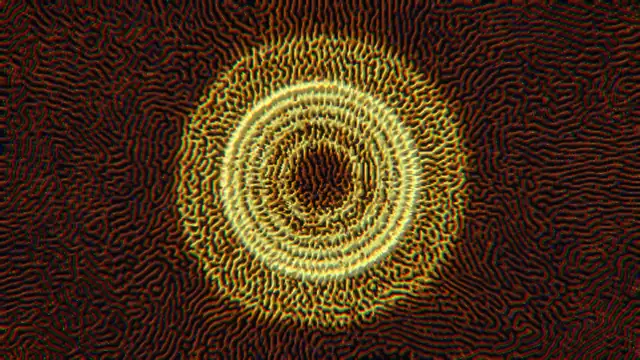
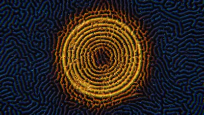
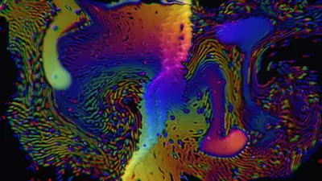
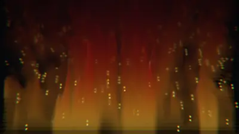
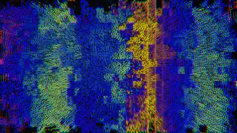
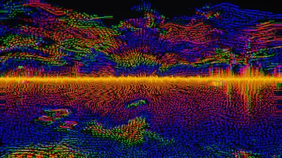
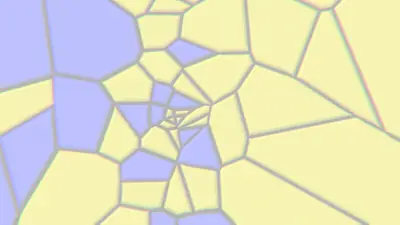
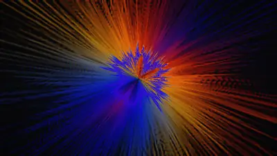
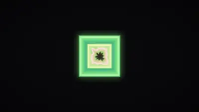
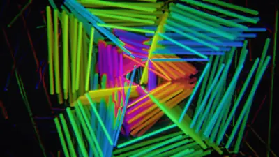

<p align="center">
  
</p>

<h1 align="center">Juglar</h1>

**Juglar** /xuˈɣlaɾ/: Spanish for *minstrel*, the medieval performer who brought music and spectacle together.

A music visualizer for Windows that **hears metal**: it tells a wall of distorted guitars from a clean chord, hears the kick, the snare and the cymbals apart, and knows when the band slams back in after a break. Written from scratch in Rust, drawn on the GPU.

<p align="center">
  
  <br>
  <sub>The break before the explosion in a death metal song, then the explosion: Juglar changes scene on the slam itself, not on a timer.</sub>
</p>

> [!WARNING]
> **Photosensitivity.** Juglar's lively scenes flash, strobe, cut hard and invert the whole screen on loud music, on purpose. They are not safe for people with photosensitive epilepsy. The *focus* and *relax* modes (`M`) are calm, dim and slow, and Juglar follows Windows' "Show animations" setting: turned off, the picture stays still.

## What makes it different

Audio-reactive visuals are old, and almost all of them listen like a level meter: how loud each band is, right now. On a loud master of a metal song that number sits near the top from the first riff to the last, and the picture just shakes.

Juglar listens for other things:

- **Grit and chaos.** How noise-like the middle of the sound is (distortion reads 0.6–0.8, a clean rock guitar about 0.2 or less), how many attacks a second, and how loud against the song's own peaks. Heavy music gets the wildest scenes and shorter ones.
- **Impacts.** The band slamming back in after a break, or a part far louder than the one before: the scene changes on that frame, with a near cut. A stop-start riff that slams every second counts once.
- **The drums apart.** Kick, snare and cymbals from a causal percussive/harmonic split, tuned against the drummers' own isolated tracks on three metal songs. Held chords are heard apart from hits.
- **Hits as springs, not swells.** A hit kicks a stiff spring that jumps, overshoots and recoils like a drum skin, instead of fading in through layers of smoothing. Hard cuts, flashes, negatives, torn colors and sliced glitches come on the hits that earn them.
- **Pictures that grow.** Every frame is a warped copy of the last, and the scenes can make that copy sharpen itself against its own surroundings, so grain grows into living texture: spots, veins and contours, like reaction and diffusion in a dish.

## The scenes

Ten made for loud music, and twelve older, calmer ones for everything else; the focus and relax modes use the stillest of them.

<table>
  <tr>
    <td></td>
    <td></td>
    <td></td>
  </tr>
  <tr>
    <td><b>Etch</b>: grain grown into an acid-etched plate; kicks re-crystallize it, an impact wipes it clean.</td>
    <td><b>Liquid</b>: the waveform poured into a marble that the drums stir, the chords color and the cymbals spark.</td>
    <td><b>Furnace</b>: a wall of fire fed by the spectrum, roaring on the kick, cracked open by impacts.</td>
  </tr>
  <tr>
    <td></td>
    <td></td>
    <td></td>
  </tr>
  <tr>
    <td><b>Datamosh</b>: the spectrum as a barcode, smeared block by block like a broken video stream.</td>
    <td><b>Static</b>: the waveform huge across a picture that tears like chewed tape.</td>
    <td><b>Fracture</b>: territories of color that every kick breaks further and an impact shatters.</td>
  </tr>
  <tr>
    <td></td>
    <td></td>
    <td></td>
  </tr>
  <tr>
    <td><b>Shrapnel</b>: a barbed ring blown apart, folded into mirror wedges when the music turns to a wall.</td>
    <td><b>Hammer</b>: a frame thrown down a tunnel at every kick.</td>
    <td><b>Wire</b>: wireframe solids burst apart by the kick, new solids at every cut.</td>
  </tr>
</table>

<sub>Recorded by Juglar itself (<code>JUGLAR_RECORD</code>) from death, thrash, groove and doom metal. Also: <i>Maelstrom</i>, and the older <i>Tide, Orbits, Kaleido, Oil, Plasma, Harmonograph, Julia, Crystal, Vortex, Corona, Melt, Lenses</i>.</sub>

## Running it

**Download:** get the zip from the [latest release](https://github.com/luchoov/juglar/releases/latest), unzip it and run `juglar.exe`. Windows 10 or 11, a GPU with DirectX 12 or Vulkan. Nothing to install, no setup: Juglar listens to whatever the speakers play. Windows may warn that the program is unrecognized, since it is not signed: *More info*, then *Run anyway*.

**From source:** with [Rust](https://rustup.rs) installed,

```
cargo run --release
```

Play anything. Juglar changes scene by itself when the music turns a corner (an explosion, a drop, a breakdown, a new song), choosing one that suits what is playing.

| Key | Does |
|---|---|
| `←` `→` | previous / next scene |
| `Space` | keep the scene showing (no automatic changes) / let go |
| `Tab` | switch to the analysis view: what Juglar hears, live |
| `M` | mode: lively (the default), focus, relax |
| `A` | intensity read from the music (the default); `1` `2` `3` fix it: gentle, medium, strong |
| `F11`, `Alt`+`Enter` or double click | fullscreen on / off |
| `W` | wallpaper mode: Juglar draws behind the desktop icons, on every display |
| `H`, `?` or `F1` | the keys, on screen |
| `Esc` | leave fullscreen; from a window, press it twice to close |

Every change a key makes is noted on screen for a moment ("Mode: focus", "Scene: Liquid, kept").

As the wallpaper, Juglar never has the keyboard, so these work from anywhere instead: `Ctrl`+`Alt`+`←` `→` change the scene on the display under the pointer, `K` keeps it, `M` changes the mode, `I` the intensity, `H` shows the keys, `W` goes back to a window. The tray icon has the same and more: with several displays, a scene on each (the default), one scene across all of them, or only one display. Juglar stops drawing on a display while a fullscreen program or a maximized window covers it.

`juglar --fullscreen` starts in fullscreen; `juglar --wallpaper`, as the wallpaper. Juglar opens no console: its messages go to `%LOCALAPPDATA%\Juglar\juglar.log`, and `juglar --console` shows them in a console instead.

**Focus** and **relax** are for when the music matters more than the picture: slow, muted, dim, scenes held for minutes and changed by a slow seep. They are style options and claim nothing about attention or stress ([why](docs/research/focus-and-relaxation.md)).

<details>
<summary>Environment variables (until there is a settings file)</summary>

- `JUGLAR_SCENE=etch` starts on that scene; `JUGLAR_MODE=focus` (or `relax`) in that mode.
- `JUGLAR_DISPLAYS=across` (or `one`) for how the wallpaper uses several displays; `each` by default.
- `JUGLAR_FPS=36` lowers the target frame rate; `JUGLAR_INTENSITY=0.3` fixes the intensity (0 to 1).
- `JUGLAR_REDUCED_MOTION=1` keeps the picture still (`0` ignores Windows' setting).
- `JUGLAR_STATS=1` prints the title's numbers once a second, with what the director hears and every scene change it makes.
- `JUGLAR_GPU_API=vulkan` (or `dx12`) forces a graphics API.
- `JUGLAR_DEMO=1` plays a silent synthetic song instead of listening.
- For working on scenes: `JUGLAR_FILE=song.wav` plays a WAV file silently instead of listening (`JUGLAR_FILE_START=60` from a minute in); `JUGLAR_RECORD=frames` saves every frame as an image at `JUGLAR_RECORD_FPS` (30) for `JUGLAR_RECORD_SECONDS`, then quits; `JUGLAR_KEEP=1` keeps the starting scene.

</details>

## How it works

The sound the speakers play is captured (WASAPI loopback), analyzed into a few dozen *signals* (levels, spectrum, beats and tempo, the drums apart, grit, chaos, impacts), and a *director* decides when to change scene and to which. Each scene turns the signals into one frame: the last picture warped, faded and worked on, new paint on top, a palette, glow and screen effects.

Every important choice is written down in plain language, with what was measured and what was given up:

- **New here?** Open [`explorables/00-start-here.html`](explorables/00-start-here.html) in a browser: sound, samples and what Juglar does, from zero, with interactive pages.
- [Vision](docs/vision.md): where it is going (song structure, a look per song, harmony as color).
- [Decisions](docs/decisions.md): fifty-five of them, D48–D55 for this release.
- [Architecture](docs/architecture.md), [roadmap](docs/roadmap.md) and [theory notes](docs/theory/).

## Limits

- Windows only for now (the core builds for the web; nothing runs there yet).
- Tuned on one playlist: metal, sludge, doom, grunge and classic rock. Electronic music and hip-hop work but nothing was tuned for them.
- Doom whose fuzz is rich in harmonics reads as clean as classic rock, so it gets no heavy pacing.
- Measured on one GPU (a GTX 1060).

## License

MIT. See [LICENSE](LICENSE).
